# Mermaid 到 draw.io

`open_drawio_mermaid` 把 Mermaid 解析成**可编辑的 draw.io 图**。它比 XML 快，但控制力弱：没有精确坐标、没有容器嵌套坐标、样式能力受 Mermaid 语法限制。

## 1. 什么时候用 Mermaid

| 场景 | 选择 |
|---|---|
| 流程图、时序图、状态机、类图、ER、甘特、思维导图、时间线 | Mermaid（快，结构清楚） |
| 需要精确位置、泳道、嵌套容器、分层 | XML |
| 需要 draw.io 原生形状（AWS/Azure/Cisco/P&ID） | XML + `search_shapes` |
| 需要逐元素主题、复杂标注、图例 | XML |
| 一次性预览、结构讨论 | Mermaid |

## 2. 图种关键字（首行写错 = 空白图）

`flowchart` / `graph`、`sequenceDiagram`、`classDiagram`、`stateDiagram-v2`、`erDiagram`、`journey`、`pie`、`gantt`、`mindmap`、`timeline`、`quadrantChart`、`requirementDiagram`、`sankey-beta`、`xychart-beta`、`block-beta`、`C4Context` / `C4Container` / `C4Component`、`architecture-beta`、`radar-beta`、`packet-beta`、`venn-beta`、`treemap-beta`、`treeView-beta`、`ishikawa-beta`、`kanban`、`zenuml`、`wardley-beta`、`eventmodeling`。

## 3. 语法硬约束

- **节点 id 不能带空格/连字符/保留字**（`end`、`class`、`subgraph`）；显示文本放括号或引号：`A["用户账户"]`。
- 一行一条语句；`;` 只在 flowchart 稳妥。
- 含 `:`、`-`、括号、中文的标签用 `"` 包裹，不要用 `'`。
- 标签里的 HTML 只有 `  <b> <i> <u>` 可靠。
- 颜色用 `#RRGGBB`，不要 `rgb()`。
- 标题用 frontmatter：

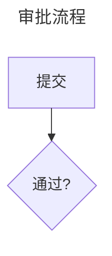

## 4. 流程图与布局

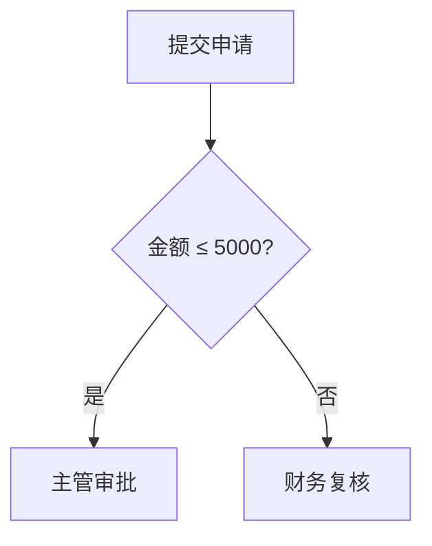

- 方向：`TD`/`TB`、`BT`、`LR`、`RL`。
- 节点形状：`[矩形]`、`(圆角)`、`([体育场])`、`[(圆柱)]`、`((圆))`、`{菱形}`、`{{六边形}}`、`[/平行四边形/]`、`>旗形]`。
- 边：`-->`、`---`、`-.->`、`==>`、`<-->`；标签 `A -->|text| B` 或 `A -- text --> B`。
- 子图：

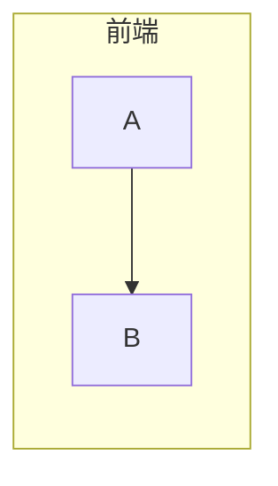

**必须上 ELK 的条件**（任一）：≥ 20 节点、≥ 3 个菱形判断、存在回边、≥ 3 个终点。调用时传 `postLayout: "elk"`；没有该参数时在源码顶部加 `config: layout: elk` 的 frontmatter。简单线性图不需要。

## 5. 样式

按角色上色，别逐节点随机配色：

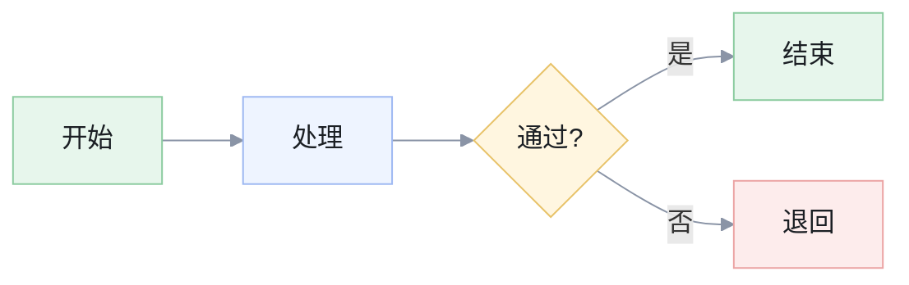

可用样式属性：`fill`、`stroke`、`stroke-width`、`stroke-dasharray`、`color`。不要混用 `style` 与 `classDef` 给同一节点。

## 6. 各图种最小骨架

**时序图**

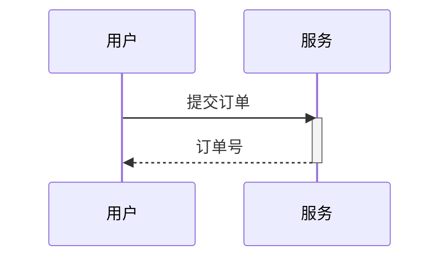

**状态机**

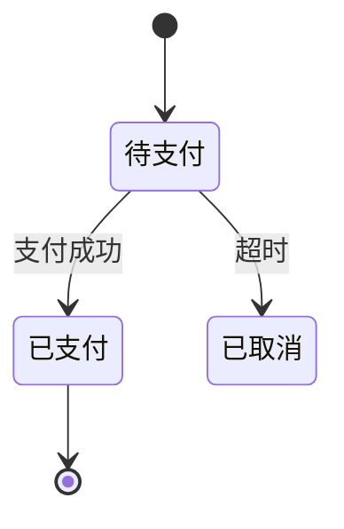

**ER**

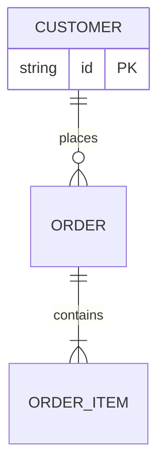

**类图**

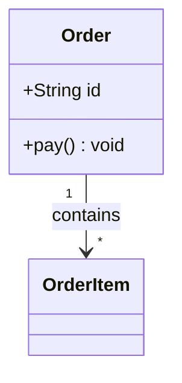

**甘特**

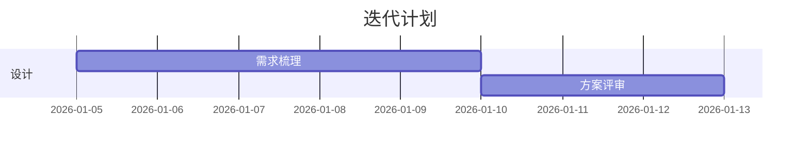

**思维导图**

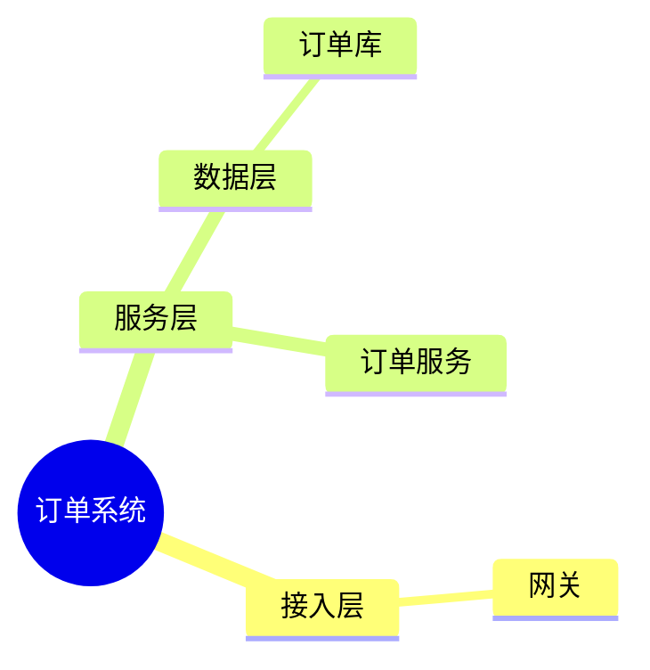

**C4 / 架构**

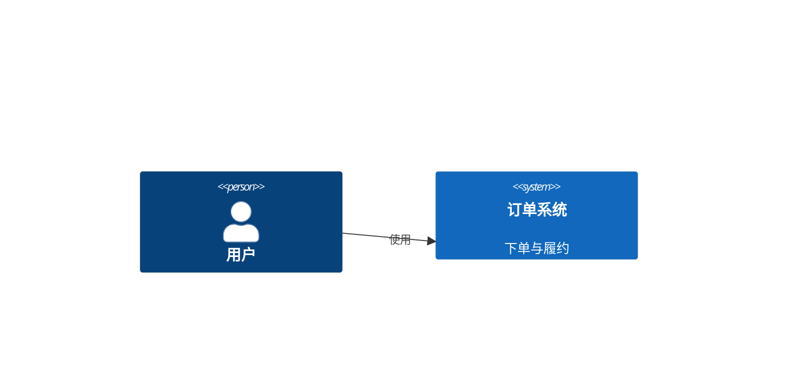

## 7. 转成 XML 的时机

Mermaid 生成的图可以编辑，但一旦需要：

- 固定画布尺寸/导出规格；
- 泳道、嵌套容器、跨容器边归属；
- 精确的每节点样式、图例、脚注；
- 与仓库里既有 `.drawio` 文件合并成多页；

就改用 XML。迁移时保留 Mermaid 的**节点清单和边清单**，用 180×120 网格重排，不要照抄 Mermaid 的自动坐标。

## 8. 常见失败

| 现象 | 原因 | 处理 |
|---|---|---|
| 空白图 | 首行关键字拼错，或用了不支持的图种 | 对照第 2 节；改用 `flowchart` |
| 解析报错 | id 含空格/连字符/保留字 | id 只留字母数字下划线 |
| 标签被截断 | 标签含 `:`、括号未加引号 | 用双引号包裹 |
| 图很挤 | 复杂流程图未上 ELK | `postLayout:"elk"` |
| 样式不生效 | 混用 `style` 与 `classDef`，或写了 `rgb()` | 统一 classDef，十六进制色 |
| 中文乱码 | 极少见；多因标签里有裸 `"` | 转义或换措辞 |
